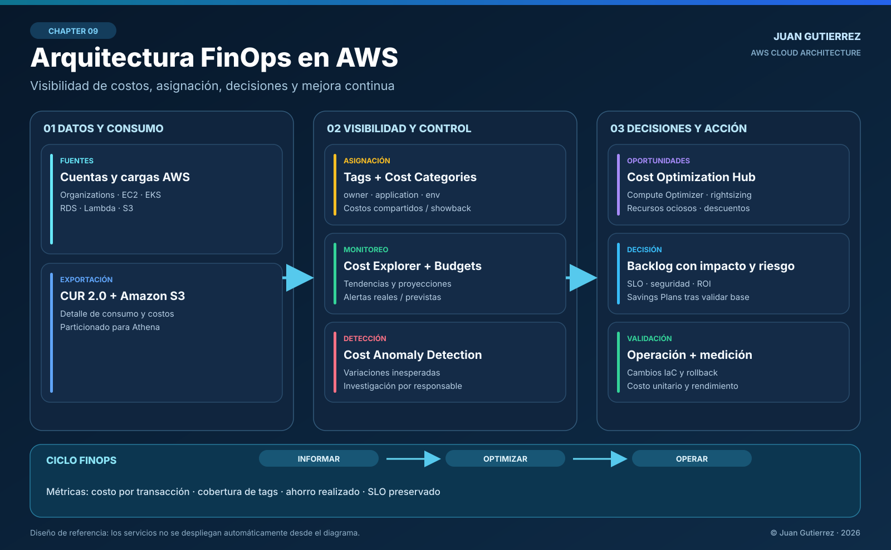

# 09 · Arquitectura con FinOps: optimizar el costo sin sacrificar la producción

**Autor:** Juan Gutierrez · AWS Cloud Odyssey · Arquitectura de producción  
**Enfoque:** visibilidad financiera, responsabilidad de costos, decisiones técnicas y mejora continua en AWS.

> Una arquitectura eficiente no es necesariamente la más barata: es la que entrega el valor y los niveles de servicio esperados con un consumo de recursos medible y defendible.

## 1. Escenario: una factura creciente no explica el problema

Imaginemos una plataforma digital en AWS con cuentas separadas para producción, pruebas y servicios compartidos. Atiende transacciones mediante **Amazon EKS**, utiliza **Amazon RDS** para persistencia, **Amazon S3** para objetos y **Amazon CloudFront** para distribución. Su tráfico crece, pero también aumentan los costos de cómputo, transferencia, observabilidad y almacenamiento.

El director financiero pregunta por qué subió la factura; operaciones responde que el tráfico aumentó. **Ambos necesitan una medida común**: cuánto cuesta servir una transacción válida manteniendo disponibilidad, latencia y seguridad.

No se debe optimizar una línea de facturación de forma aislada. Apagar capacidad o reducir retención puede parecer un ahorro mientras genera incidentes, pérdidas de datos o incumplimientos.

### Requisitos y criterios de aceptación

| Dimensión | Requisito de diseño | Cómo lo verifico |
|---|---|---|
| Transparencia | Asignar costos a producto, equipo, ambiente y cuenta | Cobertura de asignación y porcentaje no distribuido |
| Eficiencia | Medir USD por 1.000 transacciones completadas | Costos y volumen con la misma ventana temporal |
| Control | Detectar desvíos y avisar al responsable | Alertas de presupuesto y anomalías probadas |
| Fiabilidad | Preservar SLO, RTO/RPO y capacidad de pico | Pruebas de carga y revisión de errores/latencia |
| Seguridad | Restringir acceso a datos financieros y reportes | IAM, cifrado, auditoría y acceso por rol |
| Operación | Convertir recomendaciones en cambios reversibles | Backlog, responsable, plan de rollback y evidencia |

Los objetivos numéricos se acuerdan con negocio; no existe un porcentaje universal de ahorro que justifique comprometer los SLO.

## 2. Arquitectura de referencia



**Lectura del diagrama:** las cuentas y cargas de trabajo generan consumo; **AWS Data Exports (CUR 2.0)** entrega detalle a **Amazon S3** para análisis, por ejemplo con **Amazon Athena**. Las etiquetas de asignación, categorías y cuentas permiten distribuir costos. **AWS Cost Explorer**, **AWS Budgets** y **AWS Cost Anomaly Detection** aportan visibilidad y señales de control. **Cost Optimization Hub** y **AWS Compute Optimizer** alimentan un backlog técnico; el equipo ejecuta cambios con IaC, comprueba los SLO y vuelve a medir.

Esta es una **arquitectura de gobierno y análisis**, no una ruta de tráfico de la aplicación ni un despliegue automático de todos los servicios.

### Tres decisiones de implementación

**A. Informar:** habilitar Cost Explorer, definir dimensiones de costo, activar las etiquetas relevantes y configurar CUR 2.0 mediante Data Exports. Elegir granularidad y columnas según la pregunta de negocio: el detalle por recurso y los datos divididos de EKS/ECS aumentan el volumen exportado. La entrega del reporte no es en tiempo real; diseñar dashboards con fecha de actualización visible.

**B. Optimizar:** priorizar oportunidades de capacidad, recursos ociosos, transferencia y descuentos. Combinar métricas de utilización, comportamiento en picos, compromisos existentes y costo total. **Una recomendación de ahorro es una hipótesis a validar**, no una orden de ejecución.

**C. Operar:** cada acción requiere propietario, ventana, pruebas, medición antes/después y rollback. Revisar mensualmente ahorro **realizado** frente a ahorro **estimado**; el ahorro proyectado no debe contabilizarse como dinero recuperado.

## 3. Modelo de asignación: quién consume y quién responde

Propongo separar ambientes con cuentas de AWS Organizations y usar etiquetas coherentes cuando el recurso las admita:

| Etiqueta | Ejemplo | Propósito |
|---|---|---|
| `application` | `portal-clientes` | Producto o servicio |
| `environment` | `prod` | Separación de ambientes |
| `owner` | `plataforma` | Responsable de la decisión |
| `cost-center` | `cc-042` | Centro de costo |
| `managed-by` | `terraform` | Trazabilidad operativa |

**No basta con etiquetar:** las claves definidas por el usuario deben activarse como *cost allocation tags* para aparecer en los informes de facturación. El costo compartido —red, seguridad, observabilidad, servicios centrales— necesita una política documentada: distribución proporcional, por consumo o como gasto de plataforma. No forzar atribuciones falsas.

Para EKS/ECS, evaluar **split cost allocation data** en CUR 2.0 si se requiere detalle por pod/tarea; validar cobertura, complejidad y volumen antes de habilitarlo. Mantener una categoría explícita **Sin asignar** y un plan para reducirla.

## 4. Qué servicio resuelve cada pregunta

| Necesidad | Servicio / capacidad | Precaución |
|---|---|---|
| Tendencia por servicio, cuenta o etiqueta | AWS Cost Explorer | Datos de facturación con demora; no usar como telemetría en segundos |
| Detalle exportable y auditoría de consumo | AWS Data Exports, CUR 2.0, S3, Athena | Controlar accesos, esquema, almacenamiento y consultas |
| Umbral de gasto real o previsto | AWS Budgets | Las alertas **no detienen** por sí solas los cargos |
| Gastos inesperados | AWS Cost Anomaly Detection | Detección y avisos no instantáneos; investigar causas |
| Recomendaciones consolidadas | Cost Optimization Hub | Estimaciones no equivalen a ahorro realizado |
| Ajuste de tamaño | AWS Compute Optimizer | Validar memoria, picos, estacionalidad y dependencias |
| Descuentos por compromiso | Savings Plans / Reserved Instances | Riesgo de compromiso excesivo y menor flexibilidad |

### Ejemplo de métrica económica útil

Supongamos que el costo mensual **atribuido a la misma plataforma y bajo el mismo criterio** era de **USD 12.000** para **4 millones** de transacciones exitosas. Tras cambios medidos, pasa a **USD 10.500** para **5 millones**:

```text
Costo unitario inicial = 12.000 / 4.000.000 × 1.000 = USD 3,00 / 1.000 transacciones
Costo unitario final   = 10.500 / 5.000.000 × 1.000 = USD 2,10 / 1.000 transacciones
Mejora del costo unitario = (3,00 - 2,10) / 3,00 = 30 %
Cambio en gasto total = (10.500 - 12.000) / 12.000 = -12,5 %
Crecimiento del volumen = (5.000.000 - 4.000.000) / 4.000.000 = 25 %
```

La reducción del costo unitario es **30 %**, pero el ahorro total observado es **12,5 %**; son métricas diferentes. Antes de atribuirlo a una optimización, ajustar por descuentos, impuestos, cambios de mezcla, costos compartidos y periodos comparables.

## 5. Decisiones de arquitectura y compromisos

| Decisión | Beneficio esperado | Riesgo / condición de aprobación |
|---|---|---|
| Ajustar EC2/EKS según utilización | Menos capacidad sobredimensionada | Probar picos, HPA, requests/limits, disponibilidad y rollback |
| Revisar RDS y almacenamiento | Mejor relación capacidad/precio | Validar IOPS, latencia, réplicas, backup y RPO/RTO |
| Optimizar tráfico entre AZ, NAT y salida | Menos transferencia innecesaria | No sacrificar aislamiento, seguridad ni alta disponibilidad |
| Aplicar ciclo de vida en S3 | Reducir almacenamiento de datos fríos | Confirmar recuperación, retención legal y tarifas de transición |
| Usar Savings Plans | Descuento en consumo elegible estable | Evaluar cobertura, utilización y horizonte de 1 o 3 años |
| Habilitar reportes detallados | Mayor capacidad de auditoría | Costos de S3/Athena, permisos y exposición de metadatos |

**Alternativas:** cargas intermitentes pueden beneficiarse de escalado a cero o de servicios administrados; cargas estables pueden justificar compromisos. No comprar descuentos para compensar recursos mal dimensionados. Evaluar arquitectura y precios regionales con el volumen real.

## 6. Seguridad, privacidad y gobierno

- **IAM de mínimo privilegio:** separar lectores de costos, administradores de presupuestos y ejecutores de cambios; el acceso a facturación de la organización requiere permisos específicos.
- **Datos de costos:** proteger el bucket de exportaciones con bloqueo de acceso público, cifrado, políticas restrictivas, trazabilidad y retención. Revisar si etiquetas y nombres de recursos exponen datos sensibles.
- **Separación de funciones:** el equipo FinOps recomienda; el propietario del servicio autoriza cambios con impacto en producción.
- **Automatización segura:** no apagar bases de datos, instancias ni ambientes productivos automáticamente por superar un presupuesto. Exigir controles de cambio y excepciones documentadas.
- **Gobierno multicuenta:** identificar pagador, cuentas vinculadas, unidades de negocio y propietarios; aplicar una convención de tags consistente.

## 7. Runbook de anomalías de gasto

1. **Confirmar la señal:** monto, fecha, cuenta, servicio, región y variación frente al patrón histórico; recordar la latencia de los datos.
2. **Correlacionar cambios:** despliegues, escalado, jobs, snapshots, nuevas transferencias y cambios de configuración.
3. **Separar consumo de tarifa:** distinguir mayor volumen, cambio de precio, vencimiento de descuentos o cobertura insuficiente.
4. **Estimar impacto:** gasto acumulado, proyección, producto afectado y costo por unidad.
5. **Decidir y ejecutar:** cambio aprobado, plan de reversión, observabilidad de latencia/errores y seguimiento.
6. **Cerrar con evidencia:** variación real posterior, causa raíz, acción preventiva y dueño.

### Ritmo operativo

- **Diario:** revisar alertas, anomalías relevantes y desvíos grandes; no confundir datos diarios con consumo en tiempo real.
- **Semanal:** priorizar backlog de optimización por impacto, riesgo, esfuerzo y dependencia.
- **Mensual:** showback/chargeback, revisión de cobertura de etiquetas, Savings Plans, costo unitario, presupuesto y SLO.

## 8. Terraform: control básico y reproducible

Incluyo un ejemplo autocontenido en [`terraform/`](./terraform/) que crea un **AWS Budgets monthly cost budget** con dos notificaciones: gasto **real superior al 80 %** y gasto **previsto superior al 100 %**. No crea recursos de aplicación, no compra compromisos y no impone un límite automático al gasto.

```bash
cd terraform
terraform init
terraform fmt -check
terraform validate
terraform plan -var='alert_email=finops@example.com' -var='monthly_budget_usd=1000'
```

**Antes de `apply`:** sustituir el correo, validar identidad de cuenta, revisar el plan, permisos y costos. AWS Budgets actualiza la información periódicamente; los cargos pueden seguir acumulándose antes de que llegue una notificación. Las instrucciones de despliegue y retirada están en [Terraform README](./terraform/README.md).

## 9. Validación antes de producción

- [ ] El costo total y el costo unitario usan la misma ventana y base contable.
- [ ] Las cuentas, aplicaciones y propietarios tienen asignación verificable.
- [ ] Existe una categoría de costo no asignado con responsable.
- [ ] CUR 2.0 llega a S3 y se valida su fecha de actualización.
- [ ] Se comprueban presupuestos y destinatarios de alertas.
- [ ] Se prueba un escenario de anomalía o se documenta un procedimiento de simulación seguro.
- [ ] Cada cambio de optimización tiene pruebas de carga, SLO, plan de rollback y aprobación.
- [ ] El ahorro reportado distingue estimación, compromiso y reducción efectivamente observada.
- [ ] Los permisos, la protección de datos y el costo del propio sistema FinOps se revisaron.

## 10. Referencias oficiales

- [AWS Well-Architected — Cost Optimization Pillar](https://docs.aws.amazon.com/wellarchitected/latest/cost-optimization-pillar/welcome.html)
- [AWS Cost Explorer](https://docs.aws.amazon.com/cost-management/latest/userguide/ce-what-is.html)
- [AWS Data Exports — CUR 2.0](https://docs.aws.amazon.com/cur/latest/userguide/dataexports-create-standard.html)
- [Activación de etiquetas de asignación de costos](https://docs.aws.amazon.com/awsaccountbilling/latest/aboutv2/activating-tags.html)
- [AWS Budgets](https://docs.aws.amazon.com/cost-management/latest/userguide/budgets-managing-costs.html)
- [AWS Cost Anomaly Detection](https://docs.aws.amazon.com/cost-management/latest/userguide/getting-started-ad.html)
- [Cost Optimization Hub](https://docs.aws.amazon.com/cost-management/latest/userguide/cost-optimization-hub.html)
- [AWS Compute Optimizer](https://docs.aws.amazon.com/compute-optimizer/latest/ug/what-is-compute-optimizer.html)
- [AWS Savings Plans](https://docs.aws.amazon.com/savingsplans/latest/userguide/)

---

**Juan Gutierrez** · AWS Cloud Odyssey · Arquitectura · FinOps · Seguridad · Resiliencia · Infrastructure as Code
