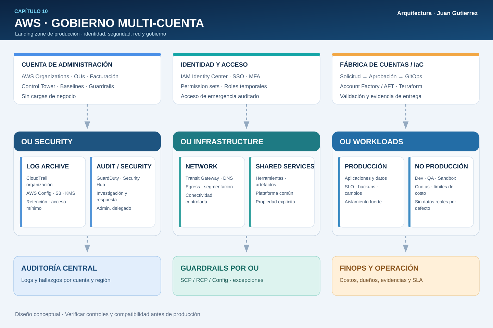

# 10 · La Organización Cloud: gobierno multi-cuenta de AWS para producción

**Autor:** Juan Gutierrez · AWS Cloud Odyssey · Arquitectura de producción  
**Enfoque:** AWS Organizations, AWS Control Tower, identidad, controles preventivos, auditoría centralizada, automatización y responsabilidad operativa.

> Escalar AWS no significa multiplicar cuentas sin control: significa establecer límites de confianza, delegar decisiones y demostrar que cada cuenta nace, opera y se retira bajo reglas verificables.

## 1. Escenario: cuando una cuenta deja de ser una frontera suficiente

Una empresa opera aplicaciones de clientes, analítica, desarrollo y servicios compartidos en AWS. Sus equipos necesitan autonomía para desplegar, pero la dirección exige aislamiento de producción, trazabilidad, acceso temporal, presupuestos por producto y respuesta coordinada ante incidentes. En una sola cuenta, los roles, cuotas, recursos y cambios de seguridad comparten demasiado contexto. Separar por cuentas ayuda, **pero una estructura de cuentas sin gobierno solo distribuye el desorden**.

La propuesta es una *landing zone* multi-cuenta con **AWS Organizations** como plano organizativo, **AWS Control Tower** para establecer y gobernar baselines donde encaje, **IAM Identity Center** para acceso humano federado, cuentas de seguridad independientes y una plataforma de provisión controlada.

### Criterios de aceptación

| Objetivo | Diseño | Evidencia exigida |
|---|---|---|
| Aislamiento | Producción y no producción en cuentas distintas | Inventario de cuentas, OUs y propietarios |
| Identidad | Acceso humano por SSO, MFA y privilegio mínimo | Asignaciones, revisiones y trazas de sesión |
| Seguridad | Logs centralizados y servicios de detección delegados | Prueba de evento y recepción en cuenta de auditoría |
| Gobierno | Guardrails por OU, sin bloquear servicios esenciales | Pruebas de denegación y excepciones registradas |
| Continuidad | Acceso de emergencia y recuperación de cuentas | Simulacro de *break-glass* documentado |
| Costos | Etiquetas, cuentas y presupuestos atribuibles | Reporte de costos y porcentaje sin asignar |
| Operación | Creación y cierre de cuentas reproducibles | PR aprobado, pipeline, evidencias y rollback |

Los requisitos legales, las regiones habilitadas y el catálogo de controles deben acordarse antes de desplegar.

## 2. Arquitectura de referencia



**Cómo leerla:** la cuenta de administración controla la organización y la facturación consolidada, pero no aloja aplicaciones. La **OU Security** agrupa cuentas de *Log Archive* y *Audit/Security Tooling*; la **OU Infrastructure** aloja red y servicios compartidos; las **OU Workloads** separan producción y no producción. Identity Center gestiona acceso humano y una canalización IaC solicita cuentas, aplica baselines y deja evidencia. Logs, hallazgos y costos fluyen a servicios centrales, mientras los equipos operan sus cuentas mediante roles limitados.

La ilustración representa **responsabilidades y flujos de gobierno**, no una topología de paquetes ni una implementación automática de todos los componentes.

## 3. Diseño de OUs: organizar por nivel de control, no por organigrama

| OU / cuenta | Propósito | Regla de operación |
|---|---|---|
| Management account | Organizations, facturación y operaciones privilegiadas | No desplegar cargas de negocio; acceso muy restringido |
| Security / Log Archive | Archivo central de CloudTrail y otros registros | Escritura desde fuentes autorizadas, lectura limitada |
| Security / Audit | Seguridad delegada, hallazgos e investigaciones | Separar investigadores de operadores de aplicaciones |
| Infrastructure / Network | Conectividad, DNS, egress e inspección compartida | Cambios con revisión y rutas documentadas |
| Infrastructure / Shared Services | Servicios comunes, artefactos y herramientas | Propietarios y costos explícitos |
| Workloads / Production | Aplicaciones y datos de clientes | Controles más estrictos y ventanas de cambio |
| Workloads / Nonproduction | QA, pruebas y desarrollo | Límites de costo y menor acceso a datos reales |
| Sandbox | Experimentación con caducidad | Presupuesto, restricciones y limpieza automática |
| Suspended / Quarantine | Cuentas retiradas o en investigación | Bloquear cambios ordinarios; retener evidencias |

**Decisión clave:** las OUs agrupan cuentas que requieren políticas similares. No conviene crear una OU por cada microservicio ni trasladar cuentas entre OUs sin evaluar qué políticas y baselines heredarán.

## 4. Guardrails: quién puede hacer qué y sobre qué recursos

**IAM** concede permisos a identidades; las **SCP de AWS Organizations** establecen límites máximos para identidades en cuentas miembro. **Una SCP no concede permisos** y no protege del mismo modo la cuenta de administración. Las **RCP** añaden límites sobre acceso a recursos compatibles, pero tampoco conceden permisos. La autorización efectiva depende de la intersección de políticas y de las excepciones y particularidades documentadas por AWS.

Ejemplos de controles que evaluaría: impedir desactivar CloudTrail/Config, restringir regiones no aprobadas, proteger cifrado y bloquear exposición pública donde aplique. **No aplicaría una denegación global sin simular primero el impacto** en despliegues, servicios administrados, roles de emergencia y baselines de Control Tower.

| Mecanismo | Útil para | No sustituye |
|---|---|---|
| SCP | Límites preventivos por OU/cuenta miembro | IAM, políticas de recurso, revisión de privilegios |
| RCP | Límites de acceso a recursos compatibles | Controles de red, cifrado y autorización IAM |
| Control Tower controls | Gobierno preventivo, detectivo o proactivo según control | Diseño de seguridad específico de la aplicación |
| AWS Config | Evidencia y evaluación de configuración | Prevención universal o protección contra toda amenaza |
| IAM Identity Center | Acceso humano con permission sets | Identidades de máquinas y acceso de emergencia |

**Control Tower no es un permiso para editar todo desde cualquier lugar:** verificar qué baselines y controles administra antes de modificar recursos asociados por fuera, porque se puede producir *drift*.

## 5. Identidad: federación, roles y acceso de emergencia

Para personas, prefiero **IAM Identity Center** integrado con el proveedor corporativo de identidad, MFA y grupos controlados. Los *permission sets* representan funciones como `ReadOnly`, `DeveloperNonProd`, `PlatformOperator` y `SecurityAuditor`. Las asignaciones se revisan periódicamente y el acceso privilegiado debe ser temporal cuando el proceso lo permita.

Para máquinas, usar roles IAM y credenciales temporales; en CI/CD, preferir federación OIDC cuando esté disponible en lugar de llaves de acceso persistentes. La cuenta de administración necesita una ruta de recuperación separada, probada y auditada. **Break-glass** no equivale a dejar un usuario administrador compartido sin MFA: documentar custodios, autenticación, alertas, duración y revocación.

Los administradores delegados pueden gestionar servicios compatibles desde cuentas miembro, pero **no todos los privilegios de la cuenta de administración son delegables**.

## 6. Seguridad y observabilidad organizacional

1. **Registro:** configurar CloudTrail de organización y destino central protegido, con cifrado, retención, acceso mínimo y pruebas de entrega; complementar con AWS Config y logs de servicios según necesidad.
2. **Detección:** habilitar servicios como Amazon GuardDuty y AWS Security Hub CSPM con administrador delegado, cobertura de cuentas y regiones comprobada, y proceso de triage.
3. **Investigación:** mantener una cuenta Audit separada de los equipos que administran las cargas; documentar cadena de custodia, permisos de consulta y conservación de evidencia.
4. **Respuesta:** aislar recursos mediante procedimientos aprobados, no mediante automatismos que puedan cortar producción sin validación.
5. **Cobertura:** verificar cuentas nuevas, regiones secundarias y cuentas en transición; un dashboard verde no demuestra que todas las fuentes estén integradas.

**Riesgo habitual:** centralizar hallazgos sin centralizar propietarios ni tiempos de respuesta. Cada alerta crítica debe indicar cuenta, recurso, equipo, severidad, runbook y canal de escalamiento.

## 7. Red y datos: servicios compartidos sin confianza implícita

La cuenta de red puede alojar Transit Gateway, Route 53 Resolver, DNS y controles de salida, según el patrón de conectividad. La conectividad entre VPC no debe convertirse en autorización lateral: aplicar segmentación, rutas explícitas, Security Groups, inspección justificada y políticas por carga. La separación de cuentas no reemplaza controles de cifrado, gestión de claves ni clasificación de datos.

Para entornos regulados, evaluar residencia de datos, exportación de logs, acceso entre regiones y replicación antes de centralizar todo en una sola ubicación. Documentar dependencias de la red compartida: una falla del plano central puede afectar muchas cuentas simultáneamente.

## 8. Provisión de cuentas como producto de plataforma

**Flujo propuesto:** solicitud de cuenta → propietario y centro de costo → aprobación → OU destino → creación/enrolamiento → baseline → identidad y logging → controles → prueba de conformidad → entrega al equipo. Mantener catálogo de cuentas, correos de raíz, responsables y procedimiento de cierre.

**AWS Control Tower Account Factory** simplifica la provisión dentro de la landing zone; **Account Factory for Terraform (AFT)** agrega un flujo GitOps para solicitudes y personalizaciones cuando se justifica su complejidad. No mezclar modificaciones manuales y automatización sobre los mismos recursos sin un contrato de propiedad. En landing zones existentes, validar la versión, las integraciones habilitadas y el mecanismo de enrolamiento antes de migrar.

Una cuenta no está lista cuando aparece en Organizations: está lista cuando **se demuestra** su logging, acceso, guardrails, etiquetas, alarmas, respaldo y propietario.

## 9. Decisiones y alternativas

| Decisión | Ventaja | Costo o riesgo |
|---|---|---|
| Control Tower sobre Organizations | Baselines y controles gobernados | Restricciones de compatibilidad y cambios de versión |
| Organizations sin Control Tower | Flexibilidad para entornos muy personalizados | Más ingeniería de plataforma y evidencia propia |
| Cuentas por ambiente y producto | Aislamiento de límites y costos | Más inventario, redes y automatización |
| Cuenta central de red | Política consistente y visibilidad | Dependencia compartida y potencial cuello operativo |
| Identity Center federado | Ciclo de vida centralizado del acceso | Dependencia del IdP y necesidad de break-glass |
| AFT / GitOps | Provisión reproducible y auditada | Pipelines, estado y permisos de alta sensibilidad |

Mi preferencia es una **landing zone mínima gobernada**, con evolución por fases: no empezar por cientos de SCP ni por un modelo de OUs imposible de mantener.

## 10. Modelo operativo y FinOps

Definir un **RACI**: plataforma es responsable de la landing zone y los baselines; seguridad aprueba excepciones y supervisa hallazgos; cada equipo de producto responde por sus recursos, vulnerabilidades y presupuestos; finanzas valida la atribución y los costos compartidos.

Medir: porcentaje de cuentas con baseline vigente, cobertura de CloudTrail/Config por región, antigüedad de accesos privilegiados, cuentas sin propietario, excepciones vencidas, hallazgos críticos fuera de SLA y costo sin asignar. El gasto de red, logs y servicios centrales debe asignarse con una regla explícita, no ocultarse.

## 11. Terraform: ejemplo de guardrail sin adjuntarlo automáticamente

La carpeta [terraform](./terraform/) contiene un ejemplo de **SCP no adjunta** para proteger el registro de auditoría en cuentas miembro. `terraform plan` permite revisar la creación de la política; por defecto **no se adjunta a ninguna OU**. Solo una aprobación explícita habilita el attachment, con una OU concreta.

```bash
cd terraform
terraform init
terraform fmt -check
terraform validate
terraform plan
# No ejecutar apply sin autorización del equipo de gobierno.
```

**Alcance:** requiere permisos de Organizations y tipo SCP habilitado; no instala Control Tower, no crea cuentas, no protege la management account y no sustituye un diseño de excepciones. Antes de adjuntar, ensayar en una OU de laboratorio y revisar interacciones con servicios administrados.

## 12. Validación antes de producción

- [ ] Inventario de cuentas, OU, propietarios, clasificación y contactos de emergencia.
- [ ] Root de cada cuenta con MFA, correo custodiado y controles de recuperación.
- [ ] Identity Center, asignaciones y privilegios de emergencia probados.
- [ ] Trail de organización y fuentes de seguridad verificadas en cuentas nuevas.
- [ ] Guardrails evaluados en laboratorio, con procedimiento de excepción y reversión.
- [ ] Regiones, conectividad y límites de datos revisados por seguridad y cumplimiento.
- [ ] Pruebas de alta/baja de cuentas, movimientos de OU y recuperación de baselines.
- [ ] Presupuestos, etiquetas y costos compartidos con responsables.
- [ ] Ejercicio de incidente: compromiso de una cuenta miembro y escalamiento a Audit.
- [ ] Evidencia de `terraform validate`, plan revisado y aprobación antes de `apply`.

### Fallas que probaría en un *game day*

**A.** Un usuario intenta detener CloudTrail en una cuenta miembro: confirmar denegación sin romper la ingestión. **B.** Un operador pierde el IdP: validar acceso de emergencia y posterior revocación. **C.** Una cuenta nueva no envía hallazgos: detectar el hueco de cobertura antes de entregar la cuenta. **D.** Se mueve una cuenta entre OUs: comprobar cambios efectivos y posibles derivas.

## 13. Referencias oficiales de AWS

- [AWS Organizations — conceptos y políticas](https://docs.aws.amazon.com/organizations/latest/userguide/orgs_introduction.html)
- [Service control policies (SCP)](https://docs.aws.amazon.com/organizations/latest/userguide/orgs_manage_policies_scps.html)
- [Resource control policies (RCP)](https://docs.aws.amazon.com/organizations/latest/userguide/orgs_manage_policies_rcps.html)
- [AWS Control Tower — guía](https://docs.aws.amazon.com/controltower/latest/userguide/what-is-control-tower.html)
- [Account Factory for Terraform (AFT)](https://docs.aws.amazon.com/controltower/latest/userguide/aft-overview.html)
- [IAM Identity Center — permission sets](https://docs.aws.amazon.com/singlesignon/latest/userguide/permissionsets.html)
- [AWS CloudTrail — organización](https://docs.aws.amazon.com/awscloudtrail/latest/userguide/creating-trail-organization.html)
- [AWS Well-Architected — Security Pillar](https://docs.aws.amazon.com/wellarchitected/latest/security-pillar/welcome.html)

---

**Juan Gutierrez** · AWS Cloud Odyssey · Capítulo 10 · Gobierno multi-cuenta · Seguridad · Operaciones · FinOps · Infrastructure as Code
