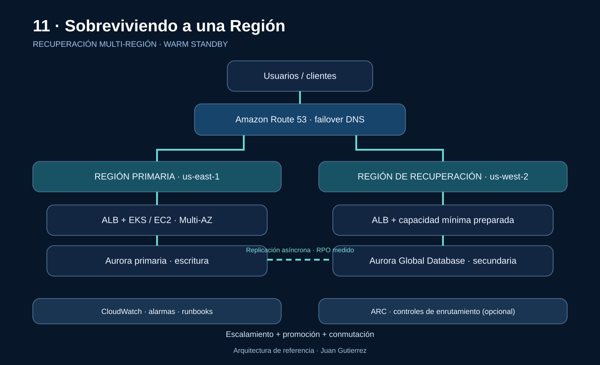

# 11 · Sobreviviendo a una Región: resiliencia y recuperación multi-Región en AWS

**Autor:** Juan Gutierrez · AWS Cloud Odyssey  
**Fecha:** 2026-11-08

> La alta disponibilidad Multi-AZ no equivale a recuperación ante la pérdida de una Región. La resiliencia comienza definiendo qué debe sobrevivir, cuánto dato puede perderse y quién autoriza la conmutación.

## Escenario y objetivos medibles

Una API de comercio procesa pedidos y pagos sobre ALB, EKS y Aurora. Opera en us-east-1 con dos o más AZ y debe recuperarse en us-west-2 ante indisponibilidad regional. Las cifras siguientes son objetivos ilustrativos, no garantías de AWS:

| Indicador | Objetivo de diseño | Cómo comprobarlo |
|---|---|---|
| RTO | ≤ 30 min | Cronometrar desde declaración hasta transacciones exitosas |
| RPO | ≤ 5 min | Comparar último commit confirmado con datos recuperados |
| Disponibilidad | 99.95% mensual | SLI externo por ruta crítica |
| Integridad | Sin doble cobro | Idempotencia y conciliación |

RTO mide el tiempo máximo tolerable para restaurar el servicio; RPO, la antigüedad máxima tolerable de los datos recuperados. Deben acordarse por proceso de negocio, no inferirse del producto elegido.

## Arquitectura de referencia



**Patrón elegido:** warm standby activo/pasivo. La Región secundaria mantiene red, controles, servicios base y capacidad mínima lista para escalar; Aurora Global Database replica asíncronamente. Route 53 dirige clientes a la Región activa, con ARC como control de conmutación opcional para cargas críticas.

### Flujo normal y recuperación

1. El cliente resuelve DNS y llega al ALB primario; la aplicación escribe únicamente en el escritor de Aurora.
2. La replicación entre Regiones es asíncrona: hay riesgo de lag y pérdida de los últimos cambios confirmados.
3. CloudWatch detecta síntomas de usuario; el equipo declara incidente y valida si procede failover.
4. Se detienen escrituras peligrosas, se promueve el secundario conforme al procedimiento probado, se escala cómputo y se conmuta el tráfico.
5. Se verifican pedidos, pagos, colas, sesiones y dependencias externas antes de declarar servicio restaurado.

## Elección del patrón de DR

| Patrón | Costo relativo | Recuperación esperada | Limitación |
|---|---|---|---|
| Backup & restore | $ | Horas; aprovisionamiento y restauración | Mayor RTO/RPO |
| Pilot light | $$ | Datos activos, aplicación por activar | Escalamiento lento |
| Warm standby | $$$ | Minutos si está ensayado | Capacidad duplicada parcial |
| Active/active | $$$$ | Menor interrupción potencial | Conflictos de escritura y complejidad |

**Decisión:** usar warm standby cuando RTO de decenas de minutos y RPO de pocos minutos justifican su costo. Multi-AZ sigue siendo la primera defensa; Multi-Región solo cuando el análisis de impacto lo exige.

## Decisiones críticas y riesgos

| Decisión | Beneficio | Riesgo y mitigación |
|---|---|---|
| Aurora Global Database | Réplicas regionales | Lag asíncrono; medir RPO real y ensayar promoción |
| Route 53 failover | Enrutamiento administrado | Caché DNS y checks superficiales; comprobar salud end-to-end |
| ARC routing controls | Guardrails de conmutación | Coste y configuración extra; probar reglas y endpoints |
| Capacidad secundaria | Menor RTO | Cuotas insuficientes; reservar y probar capacidad |
| Colas/eventos | Desacoplamiento | Duplicados; claves de idempotencia, DLQ y reconciliación |

No depender de la Región fallida para autenticación, secretos, artefactos, imágenes de contenedor, DNS, certificados, pipelines o aprobaciones operativas. Evaluar cuidadosamente el plano de control frente al plano de datos: un procedimiento que requiere crear recursos durante una caída puede incumplir el RTO.

## Seguridad y protección de datos

- Claves KMS regionales y políticas IAM mínimas; verificar acceso de operadores de emergencia sin dependencia de SSO regional.
- Replicar secretos mediante mecanismo autorizado; probar rotación, certificados TLS y límites de residencia de datos.
- Mantener CloudTrail, registros de auditoría, AWS Config y alertas accesibles fuera de la Región afectada.
- Proteger backups inmutables y separados: replicación no reemplaza recuperación ante borrado o corrupción lógica.

## Observabilidad, operación y runbook

Monitorear latencia p95/p99, errores 5xx, éxito de transacciones sintéticas desde ambas Regiones, lag de replicación, salud de endpoints, backlog de colas y capacidad disponible en DR. Las alarmas deben incluir propietario, severidad, dashboard, runbook y umbral de decisión.

**Secuencia operativa:**

1. Declarar el incidente; registrar hora T0, alcance y aprobación del responsable.
2. Comprobar estado de replicación, consistencia y dependencias externas; evaluar pérdida potencial de datos.
3. Aplicar fencing del escritor anterior para evitar split-brain; promover DB secundaria según documentación del motor.
4. Escalar EKS/EC2 en DR, verificar readiness real y conmutar DNS/ARC.
5. Ejecutar transacciones sintéticas y conciliación de pagos; declarar recuperación solo al alcanzar SLIs.
6. Preparar failback como cambio independiente; nunca revertir DNS automáticamente sin reconciliar datos.

## Terraform: ejemplo desplegable y alcance

La carpeta `terraform/` configura únicamente dos registros DNS de failover y un health check HTTP(S) sobre un endpoint primario existente. **No** crea VPC, ALB, EKS, Aurora ni ejecuta promoción. Usa un dominio y endpoints propios; `terraform plan` antes de `apply`.

```bash
cd terraform
terraform init
terraform fmt -check
terraform validate
terraform plan -var='zone_id=Z123456789EXAMPLE' -var='record_name=app.example.com' -var='primary_ip=203.0.113.10' -var='secondary_ip=198.51.100.20' -var='health_fqdn=health.example.com'
```

**Advertencia:** las IP y la zona son ejemplos; reemplázalas por destinos reales. Un chequeo HTTP 200 aislado no prueba salud de la aplicación; protege el endpoint con validaciones de dependencias críticas. DNS puede tardar más que su TTL por cachés de resolvers/clientes.

## FinOps y dimensionamiento

Presupuestar cómputo de reserva, almacenamiento y réplicas Aurora, transferencia interregional, solicitudes de Route 53/health checks, monitoreo y pruebas DR. Mantener capacidad mínima solo si el tiempo medido de escalamiento cumple RTO; considerar reservas/cuotas de capacidad y pruebas de carga en la Región secundaria.

## Validación de producción

- [ ] BIA aprobado, RTO/RPO por servicio y responsables de failover definidos
- [ ] Prueba controlada de caída regional con cronómetro y evidencia de RPO
- [ ] Promoción de base de datos y fencing probados sin split-brain
- [ ] Capacidad, cuotas, imágenes y secretos disponibles en DR
- [ ] Alarmas, salud sintética, DNS y runbook validados
- [ ] Integridad de pagos, idempotencia, backups y restauración comprobados
- [ ] Costos y residencia de datos aprobados

## Referencias oficiales de AWS

- [Disaster Recovery of Workloads on AWS](https://docs.aws.amazon.com/pdfs/whitepapers/latest/disaster-recovery-workloads-on-aws/disaster-recovery-workloads-on-aws.pdf)
- [AWS multi-Region decision framework](https://docs.aws.amazon.com/prescriptive-guidance/latest/security-reference-architecture/multi-region-architecture.html)
- [Amazon Application Recovery Controller](https://docs.aws.amazon.com/r53recovery/latest/dg/what-is-route53-recovery.html)
- [Route 53 DNS failover](https://docs.aws.amazon.com/en_en/Route53/latest/DeveloperGuide/dns-failover-types.html)
- [Database RTO/RPO guidance](https://docs.aws.amazon.com/prescriptive-guidance/latest/strategy-database-disaster-recovery/choosing-database.html)

---

*Juan Gutierrez · AWS Cloud Odyssey · Arquitecturas de producción*
