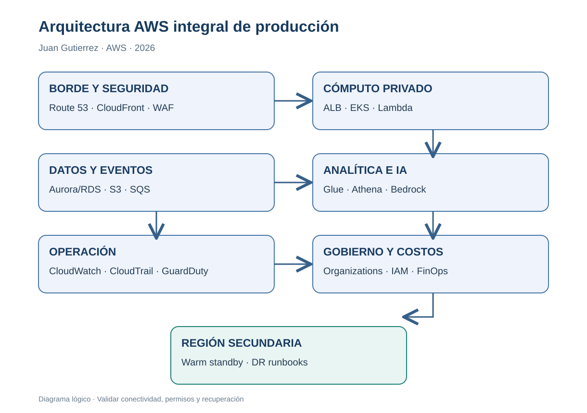

# 12 · La Arquitectura Final — Un sistema AWS preparado para producción

**Autor:** Juan Gutierrez · AWS Cloud Odyssey · Capítulo final

> Una arquitectura de producción no es la suma de servicios. Es un conjunto de decisiones verificables sobre seguridad, resiliencia, rendimiento, operación y costo.

## Escenario y objetivos

Una plataforma digital regional procesa transacciones, expone APIs, ejecuta procesos asíncronos y ofrece búsqueda asistida por IA. Necesita separación entre equipos y entornos, auditoría, recuperación ante fallos, despliegues reproducibles y visibilidad del costo por producto.

**Objetivos ilustrativos, no garantías:** disponibilidad mensual de 99,95 % para APIs críticas; latencia p95 inferior a 400 ms en rutas síncronas; RPO de 5 minutos y RTO de 60 minutos para el servicio transaccional ante pérdida regional, sujetos a pruebas. Definir presupuesto, residencia de datos y clasificación de información antes de elegir servicios.

## Arquitectura de referencia



*Diagrama de referencia; las flechas indican flujos lógicos, no conectividad automáticamente habilitada.*

### Camino de una solicitud

1. **Entrada y protección:** Route 53 resuelve dominios; CloudFront termina la distribución de contenido; AWS WAF inspecciona solicitudes; ALB enruta a servicios HTTP privados. Shield Standard aporta protección DDoS básica; no sustituye pruebas de abuso.
2. **Aplicación:** Amazon EKS aloja servicios que requieren orquestación; Lambda atiende eventos y tareas de duración acotada. API Gateway puede exponerse para APIs administradas, sin colocarlo obligatoriamente delante de cada ALB.
3. **Persistencia:** Aurora/RDS Multi-AZ atiende transacciones; S3 almacena objetos; EventBridge, SQS y Step Functions desacoplan flujos. Diseñar idempotencia, DLQ, backpressure y límites de concurrencia.
4. **Datos e IA:** S3 y Glue alimentan una zona analítica gobernada con Lake Formation y Athena. Bedrock usa datos autorizados mediante recuperación con filtros y controles de acceso; jamás se le otorga acceso implícito a toda la base transaccional.
5. **Operación:** CloudWatch y OpenTelemetry capturan señales; CloudTrail y Config aportan auditoría y estado; GuardDuty y Security Hub agregan hallazgos de seguridad.
6. **Continuidad:** región primaria Multi-AZ, región secundaria con warm standby para componentes seleccionados y procedimientos explícitos de failover/failback. La replicación asíncrona puede perder escrituras recientes.
7. **Gobierno y costo:** Organizations, Control Tower, IAM Identity Center, SCP y cuentas separadas; etiquetas, Cost Explorer, Budgets y CUR 2.0 sustentan showback y decisiones FinOps.

## Decisiones y alternativas

| Decisión | Por qué | Compromiso y alternativa |
|---|---|---|
| Multi-cuenta por entorno y responsabilidad | Aislamiento y límites de impacto | Más gobierno; evitar proliferación sin automatización |
| EKS solo para servicios con necesidad real de Kubernetes | Portabilidad de despliegues y control | Complejidad operativa; ECS/Fargate o Lambda pueden ser más simples |
| Aurora/RDS Multi-AZ para transacciones | Alta disponibilidad zonal | No equivale a DR regional; evaluar Global Database y backups |
| Eventos con SQS/EventBridge | Resiliencia ante picos y desacoplamiento | Consistencia eventual; deduplicación e idempotencia |
| Bedrock con recuperación autorizada | Reduce exposición de datos y fundamenta respuestas | Evaluación de calidad, costo por token y riesgo de prompt injection |
| Warm standby selectivo | RTO menor que backup/restore | Costo permanente; ensayar promoción y retorno |
| IaC y políticas preventivas | Cambios revisables y repetibles | Errores de política pueden bloquear operaciones |

## Seguridad y privacidad desde el diseño

- **Identidad:** acceso humano federado con IAM Identity Center, MFA y roles temporales; roles IAM de carga con permisos mínimos; negar acceso público no justificado.
- **Red:** subredes privadas, security groups mínimos, VPC endpoints cuando convenga y egreso controlado; documentar rutas, DNS y dependencias entre cuentas.
- **Datos:** cifrado en tránsito y reposo con KMS cuando corresponda, rotación de secretos, clasificación, retención y borrado; evitar datos sensibles en logs y prompts.
- **Cadena de suministro:** escaneo de imágenes, dependencias fijadas, firma/procedencia de artefactos, revisión de Terraform y despliegue progresivo.
- **IA:** aislar instrucciones no confiables de documentos recuperados; autorizar acceso por identidad y evaluar filtraciones, exactitud y respuestas inseguras.

## Resiliencia y recuperación

La redundancia entre zonas protege contra fallos zonales, no garantiza continuidad ante una caída regional. Mantener backups independientes, restauraciones ensayadas y un plan de conmutación con criterios de activación, propietarios y comunicación. Comprobar dependencias regionales (identidad, claves, colas, DNS, certificados, secretos y capacidad de cómputo). No anunciar RTO/RPO sin medirlos en simulacros.

**Ejercicio mínimo:** degradar un servicio, confirmar alarma basada en SLO, ejecutar rollback, restaurar datos en un entorno aislado, medir RPO/RTO y registrar acciones de mejora. En DR regional, probar también failback y evitar escritores simultáneos.

## Observabilidad y respuesta

Instrumentar métricas RED (tasa, errores, duración), saturación, trazas correlacionadas y logs estructurados con identificadores de solicitud. Cada alerta accionable debe indicar propietario, impacto, dashboard, runbook y canal de escalamiento. Probar que la telemetría sobreviva a la indisponibilidad parcial del servicio.

## FinOps y sostenibilidad operativa

Definir centros de costo y etiquetas obligatorias, presupuestos con umbrales, revisión de recursos ociosos, dimensionamiento y políticas de retención. Evaluar Savings Plans solo tras observar uso estable. Incluir el costo del standby regional, transferencias, telemetría, NAT, llamadas a Bedrock y consultas analíticas. Optimizar **costo por transacción útil**, no únicamente la factura total.

## Implementación progresiva

1. **Fundación:** cuentas, guardrails, identidad, logging central y redes base.
2. **Producto mínimo:** borde seguro, un servicio, datos y CI/CD con rollback.
3. **Resiliencia:** pruebas Multi-AZ, backups restaurables y SLO operativos.
4. **Integraciones:** mensajería, analítica e IA con controles de datos.
5. **DR regional:** warm standby, runbooks, simulacros y evidencia de RTO/RPO.
6. **Optimización:** capacity planning, seguridad continua, FinOps y postmortems.

## Ejemplo Terraform seguro

La carpeta [terraform](./terraform/) contiene una **base demostrativa**: un grupo de logs de CloudWatch con retención configurable y etiquetas. No crea EKS, RDS, redes ni políticas de producción. Requiere credenciales AWS configuradas y permisos de CloudWatch Logs.

```bash
cd terraform
terraform init
terraform fmt -check
terraform validate
terraform plan -var='environment=dev'
```

No ejecutar `terraform apply` sin revisar cuenta, región, permisos, costos y plan. Para una plataforma completa separar módulos, estados remotos, pipelines y aprobaciones por entorno.

## Checklist de salida a producción

- [ ] SLO/SLI, presupuesto y propietarios aprobados
- [ ] Cuentas, roles, secretos y cifrado revisados
- [ ] Pruebas de carga, límites y escalado documentados
- [ ] Backups restaurados y DR probado con RTO/RPO medidos
- [ ] Logs, métricas, trazas, alertas y runbooks operativos
- [ ] Análisis de amenazas, pruebas de seguridad y control de cambios
- [ ] IaC revisada, rollback ensayado y costos etiquetados
- [ ] Pruebas de IA, autorización y privacidad completadas

## Fuentes oficiales AWS

- [AWS Well-Architected Framework](https://docs.aws.amazon.com/wellarchitected/latest/framework/welcome.html)
- [AWS Organizations](https://docs.aws.amazon.com/organizations/latest/userguide/orgs_introduction.html)
- [Amazon EKS](https://docs.aws.amazon.com/eks/latest/userguide/what-is-eks.html)
- [Amazon EventBridge](https://docs.aws.amazon.com/eventbridge/latest/userguide/eb-what-is.html)
- [Amazon Bedrock](https://docs.aws.amazon.com/bedrock/latest/userguide/what-is-bedrock.html)
- [AWS Disaster Recovery](https://docs.aws.amazon.com/whitepapers/latest/disaster-recovery-workloads-on-aws/disaster-recovery-workloads-on-aws.html)
- [Amazon CloudWatch](https://docs.aws.amazon.com/AmazonCloudWatch/latest/monitoring/WhatIsCloudWatch.html)
- [AWS Cost Management](https://docs.aws.amazon.com/cost-management/latest/userguide/what-is-costmanagement.html)

---

**Juan Gutierrez** · AWS Cloud Odyssey · Seguridad · Resiliencia · Observabilidad · FinOps · IaC